# 将Sites Optimizer与Jira集成

在不离开AEM Sites Optimizer的情况下将机会问题转化为Jira票证。 每个票证都包含受影响的页面、问题详细信息和建议的修复，因此您的团队可以在Jira中计划和跟踪工作。 建议为所选问题设置代码修补程序后，Sites Optimizer会将其附加到票证。

<!-- VIDEO TODO: end-to-end overview (connect, configure, create). Upload through Experience League, then replace this comment with the video shortcode using the hosted video ID. -->

>[!NOTE]
>
>该集成仅适用于&#x200B;**Jira Cloud**&#x200B;站点。 不支持Jira数据中心和Jira服务器。

<!-- CONFIRM: availability wording. Trial users get the integration by default. Confirm what to tell paid customers (enablement through the account team / CSE?). The Create Jira ticket dialog shows a Beta badge, so confirm whether to say Beta or Early Access. -->

>[!AVAILABILITY]
>
>如果您在&#x200B;**设置**&#x200B;或&#x200B;**创建票证**&#x200B;中看不到&#x200B;**连接到Jira Cloud**，请联系您的客户团队或客户成功工程师。

## 工作原理 {#how-it-works}

设置集成需要三个阶段：

| 暂存 | 谁执行 | 位置 |
|---|---|---|
| [准备您的帐户](#prerequisites) | Jira站点管理员和Adobe组织管理员 | Atlassian管理和Adobe Admin Console |
| [连接Jira并设置默认值](#configure-jira) | 授权连接的Sites Optimizer用户 | Sites Optimizer中的&#x200B;**设置** |
| [创建票证](#create-tickets) | 任何从事机会工作的人 | 机会页面 |

为您的组织完成前两个阶段一次。 之后，拥有访问权限的任何人都可以从支持的机会中创建票证。

## 准备帐户 {#prerequisites}

Sites Optimizer代表授权连接的帐户创建Jira票证。 连接之前，请在Jira和Adobe中准备该帐户。 这些步骤适用于每个Jira云站点。

>[!TIP]
>
>使用专用服务帐户进行连接，例如`aso-jira@yourcompany.com`，而不是个人帐户。 虽然可以使用个人帐户，但不建议这样做：代表该用户创建票证，并且连接取决于其访问权限。

### 邀请帐户访问您的Jira网站 {#invite-to-jira}

1. 转到[admin.atlassian.com](https://admin.atlassian.com)，选择您的组织，然后选择&#x200B;**邀请用户**。

   包含“邀请用户”快速操作的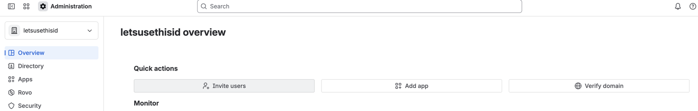{align="center"}

1. 输入帐户的电子邮件地址。
1. 在&#x200B;**应用程序**&#x200B;列表中，找到&#x200B;**Jira**&#x200B;并将&#x200B;**角色**&#x200B;设置为&#x200B;**用户**。 请勿使用&#x200B;**来宾**，它仅允许访问一个分配的空间。

   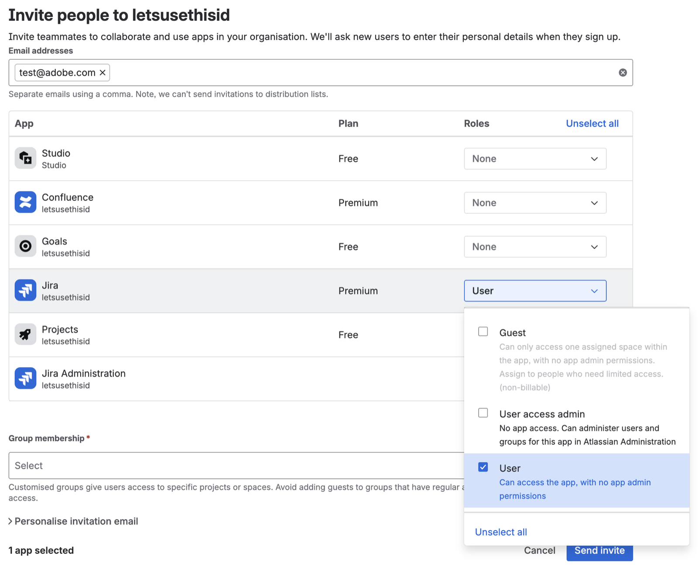{align="center"}

1. 将&#x200B;**组成员资格**&#x200B;设置为默认Jira组`jira-users-<site>`。 这将授予产品访问权限和内置&#x200B;**成员**&#x200B;项目角色。

   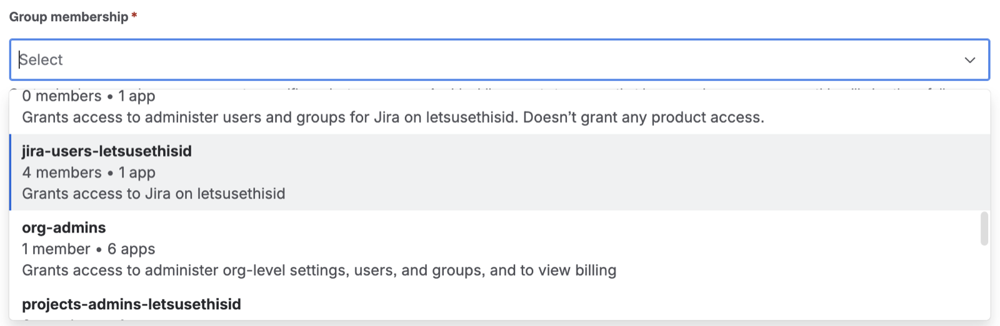{align="center"}

1. 确认角色为&#x200B;**用户**，群组为`jira-users-<site>`，然后选择&#x200B;**发送邀请**。

受邀帐户接受邀请并使用Atlassian帐户登录或创建该帐户。

>[!IMPORTANT]
>
>必须允许该帐户在您希望Sites Optimizer创建票证的每个Jira项目中创建问题。 如果您的项目使用自定义权限方案，请让您的Jira管理员授予该帐户&#x200B;**创建问题**&#x200B;权限。

### 授予该帐户访问Sites Optimizer的权限 {#grant-aso-access}

授权Jira连接的帐户必须能够登录到贵组织的Sites Optimizer。 授予该访问权限的方式取决于您的Sites Optimizer计划。

>[!BEGINTABS]

>[!TAB 付费客户]

将该帐户添加到Adobe Admin Console中的AEM Sites Optimizer产品配置文件：

1. 转到[adminconsole.adobe.com](https://adminconsole.adobe.com)并选择&#x200B;**产品** > **Adobe Experience Manager Sites Optimizer**。
1. Select帐户所需的产品配置文件。 Jira集成在所有Sites Optimizer产品配置文件中可用。

   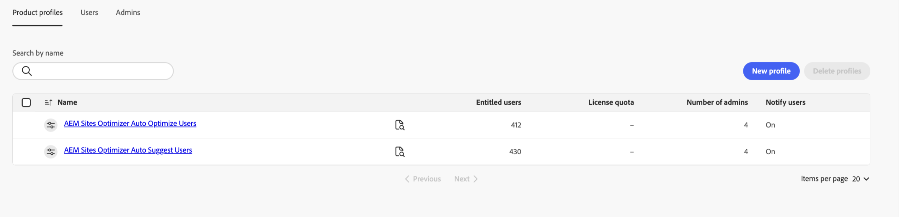{align="center"}

1. Select **用户**&#x200B;选项卡，选择&#x200B;**添加用户**，输入帐户的电子邮件地址，然后选择&#x200B;**保存**。

有关产品配置文件和角色的更多信息，请参阅[管理用户权限](/help/documentation/manage-permissions.md)。

>[!TAB 试用客户]

Sites Optimizer试用版不包括Admin Console中的Sites Optimizer产品配置文件。 实际上，该帐户需要访问Adobe组织中的Adobe Experience Manager：

1. 确保该帐户是Adobe组织中的用户。
1. 确保为帐户分配了至少一项产品的产品配置文件：

   * **Adobe Experience Manager as a Cloud Service**
   * **Adobe Experience Manager Managed Services**
   * **Adobe Experience Manager Edge Delivery Services**

   如果该帐户没有这些产品配置文件之一，请让您的Adobe组织的系统管理员在[Adobe Admin Console](https://adminconsole.adobe.com)中分配一个。

1. 使用帐户登录Sites Optimizer并选择您的组织。 请参阅[Sites Optimizer试用版](/help/documentation/trial.md)。

>[!ENDTABS]

>[!IMPORTANT]
>
>在授权Jira连接&#x200B;**之前，将该帐户添加到您的Adobe组织**。 否则，连接将失败，并显示“您不是此组织的成员”。

## 连接Jira并设置票证默认值 {#configure-jira}

<!-- VIDEO TODO: connect and configure Jira (about 60 seconds). -->

### 连接到 Jira {#connect-to-jira}

<!-- CONFIRM: only an administrator can connect Jira and set ticket creation defaults? Carried over from PR #162; not confirmed. -->

1. 使用您准备的帐户登录Sites Optimizer 。
1. Select **设置**&#x200B;并转到&#x200B;**连接到Jira Cloud**&#x200B;部分。 新连接显示状态&#x200B;**未连接**。

   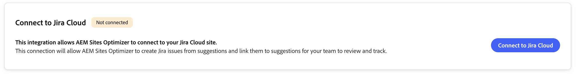{align="center"}

1. Select **连接到Jira Cloud**。
1. 在Atlassian页面上，授权连接，并在出现提示时选择您的Jira站点。

   <!-- SCREENSHOT TODO: {align="center"} -->

当您返回Sites Optimizer时，状态将更改为&#x200B;**已连接**，并且部分显示带有Jira站点URL的&#x200B;**已连接站点**。

>[!NOTE]
>
>该连接适用于您的整个组织。 它由所有网站和用户共享，在&#x200B;**设置**&#x200B;中所做的任何更改都适用于每个人。 您可以一次连接一个Jira站点。 要使用其他Jira站点，请先断开当前站点。

### 设置票证创建默认设置 {#ticket-defaults}

连接后，设置Sites Optimizer应用于每个票证的默认值。

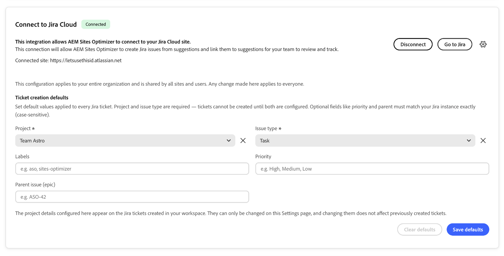{align="center"}

| 字段 | 必需 | 描述 |
|---|---|---|
| **项目** | 是 | 创建票证的Jira项目。 |
| **问题类型** | 是 | 新票证的Jira问题类型，如&#x200B;**任务**。 在选择项目后可用。 |
| **标签** | 否 | 标签已添加到每个票证，如`aso`或`sites-optimizer`。 |
| **优先级** | 否 | 默认票证优先级，如&#x200B;**高**、**Medium**&#x200B;或&#x200B;**低**。 |
| **父问题（史诗）** | 否 | 要将票证链接到的史诗密钥，如`ASO-42`。 |

Select **保存默认值**。 出现“票证默认已保存”消息确认更改。

>[!IMPORTANT]
>
>在设置&#x200B;**项目**&#x200B;和&#x200B;**问题类型**&#x200B;之前，无法创建票证。 **优先级**&#x200B;和&#x200B;**父问题(epic)**&#x200B;必须完全匹配您的Jira值，包括大小写。

您对默认票证所做的更改仅适用于新票证。 您创建的票证不会发生更改。 在创建票证时，您可以更改该票证的任意这些值，而不会影响保存的默认值。

### 验证连接 {#verify-connection}

确认设置是否有效：

* **票证创建默认值**&#x200B;中的&#x200B;**项目**&#x200B;列表显示了您的Jira项目。
* 从opportunity创建票证将返回Jira票证密钥和链接。
* 如果针对这些问题建议了代码修补程序，则该票证会将其作为附件包含在内。

### 管理连接 {#manage-connection}

使用&#x200B;**连接到Jira Cloud**&#x200B;部分中的按钮管理连接：

* **转到Jira**：打开您连接的Jira站点。
* **重新连接到Jira**：当状态为&#x200B;**需要重新授权**&#x200B;时出现。 Select它，并再次授权与同一Jira站点连接。
* **断开**：在您确认&#x200B;**断开Jira？**&#x200B;后，删除集成。 在再次连接之前，您将无法从机会创建票证。
* **清除默认值**：删除所有保存的默认值。 票证创建将一直不可用，直到您再次设置&#x200B;**项目**&#x200B;和&#x200B;**问题类型**。

### 连接错误疑难解答 {#connection-errors}

| 消息 | 要做什么 |
|---|---|
| 您不是此组织的成员。 在连接Jira之前，请要求管理员添加您。 | 将帐户添加到您的Adobe组织和产品配置文件。 请参阅[授予帐户访问Sites Optimizer](#grant-aso-access)的权限。 |
| 您选择了其他Jira站点。 首先断开当前连接，然后连接新站点。 | Select **断开连接**，然后连接所需的Jira站点。 |
| 您的组织已存在与此 Jira 网站的连接。 | 该站点已连接。 打开&#x200B;**设置**&#x200B;以查看连接。 |
| Jira授权被拒绝。 请在出现提示时重试并授予访问权限。 | Select **再次连接到Jira Cloud**&#x200B;并允许访问Atlassian页面。 |
| 授权会话已过期。 请重新尝试连接。 | Select **再次连接到Jira Cloud**，并在10分钟内完成Atlassian授权。 |

## 从机会创建Jira票证 {#create-tickets}

您可以从以下七个机会创建票证：

* [缺少替代文本](/help/documentation/opportunities/missing-alt-text.md)
* [中断的反向链接](/help/documentation/opportunities/broken-backlinks.md)
* [中断的内部链接](/help/documentation/opportunities/broken-internal-links.md)
* [Core Web Vitals](/help/documentation/opportunities/core-web-vitals.md)
* [辅助功能问题](/help/documentation/opportunities/accessibility-issues.md)（修复ARIA标签）
* 颜色对比度
* [表单无障碍可访问性问题](/help/documentation/opportunities/forms-accessibility-issues.md)

<!-- CONFIRM: the docs repo has no page for the Color contrast opportunity (accessibility-issues.md does not mention it). Link it once a page exists. -->

本文中的示例使用“缺少替换文本”、“断开的反链接”和“核心Web重要信息”。 其他机会的步骤相同。

<!-- VIDEO TODO: create a ticket from an opportunity (about 60-90 seconds). -->

### 创建票证 {#create-a-ticket}

每个受支持的机会的步骤都相同。

1. 打开商机并选择一个或多个问题。
1. Select **创建票证**。

   如果Jira未连接，则页面显示&#x200B;**配置Jira**。 Select以在&#x200B;**设置**&#x200B;中打开Jira部分，然后完成[连接Jira并设置票证默认值](#configure-jira)。

1. 在&#x200B;**创建Jira票证**&#x200B;对话框中，查看票证详细信息。 该对话框会预先填充您的默认值和选定的问题。
1. 选择&#x200B;**创建**。

该对话框包含以下字段：

| 字段 | 描述 |
|---|---|
| **票证名称** | 票证摘要。 必需。 |
| **标记** | 标签已添加到Jira票证。 |
| **项目** | Jira项目。 必需。 |
| **优先级** | 票证优先级。 |
| **问题类型** | Jira问题类型。 必需。 首先Select项目。 |
| **Epic（父级）** | 父史诗的键，如`ASO-42`。 |
| **问题名称**&#x200B;和&#x200B;**问题描述** | 每个选定问题对应一对。 编辑它们以调整票证对每个问题的说明。 |

Sites Optimizer创建票证并显示“已创建Jira票证”。 票证的Jira密钥作为链接显示在问题列表的&#x200B;**票证链接**&#x200B;列中。 Select该链接可在Jira中打开票证。 没有票证的问题会显示短划线(-)。

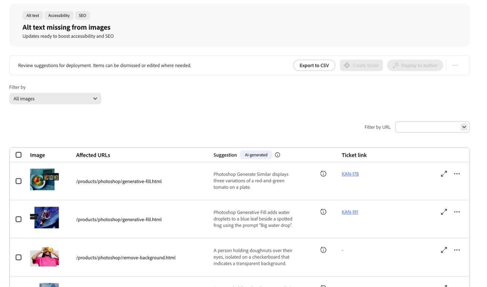{align="center"}

>[!NOTE]
>
>选择多个问题后，Sites Optimizer将创建一个分组票证&#x200B;**并列出每个选定问题**。 它不会为每个问题创建单独的票证。 每个问题只能属于一个票证。 如果未选择任何问题，或任何选择的问题已有票证，则&#x200B;**创建票证**&#x200B;被禁用。 清除已显示票证链接的问题，然后选择&#x200B;**创建票证**。

<!-- CONFIRM: the Accessibility dialog uses a single Title and Description editor (with Preview) instead of per-issue Issue Name/Issue Description cards. Decide whether to call this out. Also confirm the accessibility code-fix attachment wording: it is attached only when the code-patch auto-fix is enabled. -->

在&#x200B;**问题描述**&#x200B;和&#x200B;**描述**&#x200B;字段中，您可以使用Markdown，例如`**bold**`、`*italic*`、`- bullets`和编号列表。 切换到&#x200B;**预览**&#x200B;以检查格式。

以下示例利用每个Sites Optimizer客户都可以使用的机会，因此您在任何计划中都可以看到相同的体验。 第一个示例为一个问题创建票证，第二个示例为多个问题同时创建票证，第三个示例显示带有代码修补程序附件的票证。

### 示例：创建一个问题的票证 {#example-single-issue}

当某个修补程序需要其自身的所有者或截止日期时，请使用单个问题的票证。 此示例使用&#x200B;**缺少替换文字**。

1. 打开&#x200B;**缺少替换文字**&#x200B;并选择一幅图像。

   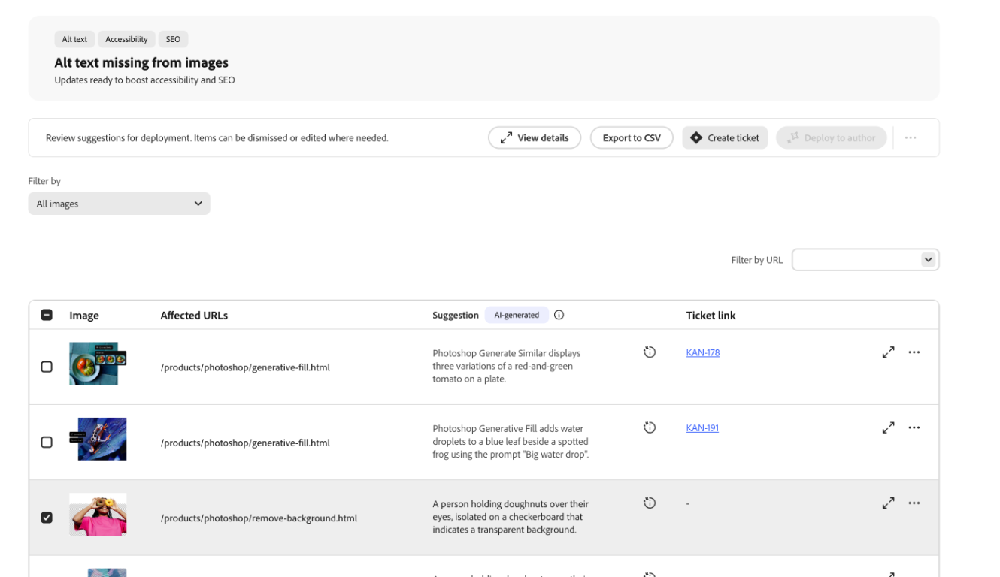{align="center"}

1. Select **创建票证**。
1. 在&#x200B;**创建Jira票证**&#x200B;对话框中，保留预填充的&#x200B;**票证名称**，如`[ASO] Missing alt text – found on https://www.adobe.com/products/photoshop/generative-fill.html`，或者对其进行编辑。
1. 查看&#x200B;**问题名称**&#x200B;和&#x200B;**问题描述**。 该描述列出了&#x200B;**页面URL**、**图像URL**&#x200B;和&#x200B;**建议的替换文本**。

   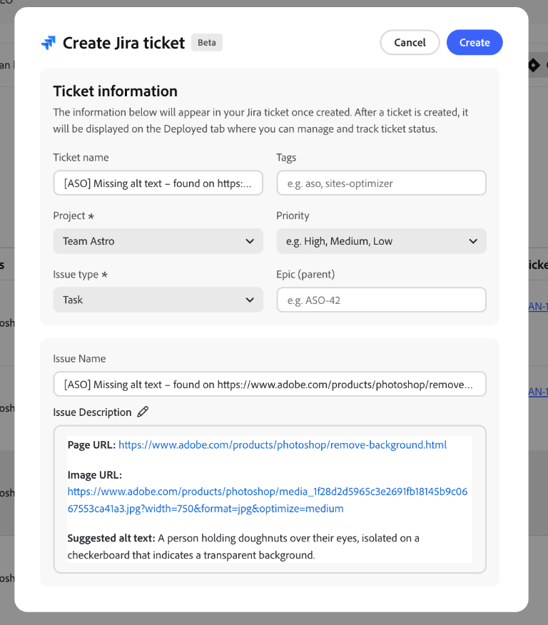{align="center"}

1. 选择&#x200B;**创建**。

Jira票证列出了受影响的页面，然后是问题：

```markdown
**Affected pages:**
- https://www.adobe.com/products/photoshop/generative-fill.html

---

**[ASO] Missing alt text – found on https://www.adobe.com/products/photoshop/generative-fill.html**

**Page URL:** https://www.adobe.com/products/photoshop/generative-fill.html

**Image URL:** https://www.adobe.com/cc-shared/fragments/products/photoshop/generative-fill/personalization/media_1986ceaab1420f3df0c4ff92b962e01bd402c0d53.jpg?width=750&format=jpg&optimize=medium

**Suggested alt text:** Photoshop Generate Similar displays three variations of a red-and-green tomato on a plate.
```

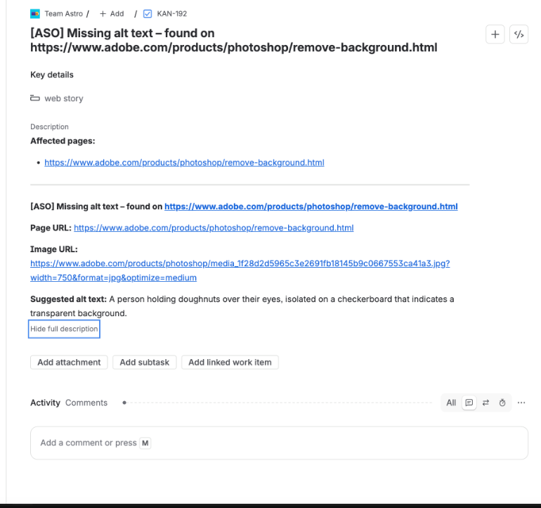{align="center"}

### 示例：为多个问题创建一个票证 {#example-multiple-issues}

当一个团队同时修复多个问题时，请使用分组票证。 此示例使用&#x200B;**断开的反向链接**。

1. 打开&#x200B;**断开的反链接**&#x200B;并选择多个反链接。
1. Select **创建票证**。
1. 在&#x200B;**创建Jira票证**&#x200B;对话框中，查看&#x200B;**票证名称**。 选择多个问题后，它会显示受影响的页面数量，如`[ASO] Broken backlink found – 2 pages`。 该对话框为每个选定的反向链接显示一个&#x200B;**问题名称**&#x200B;和&#x200B;**问题描述**&#x200B;对。

   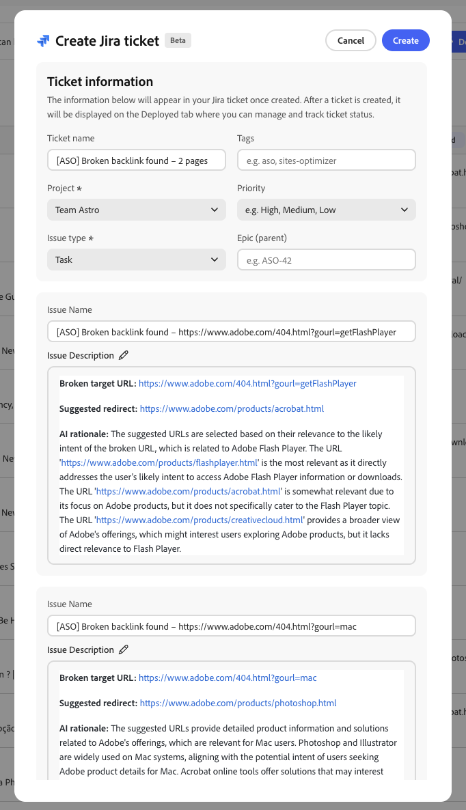{align="center"}

1. 对于每个反向链接，请查看&#x200B;**损坏的目标URL**&#x200B;和&#x200B;**建议的重定向**。 当可用时，该描述还包含&#x200B;**AI原理**。 如果您编辑了Opportunity中建议的重定向，则该票证将使用您编辑过的URL。
1. 选择&#x200B;**创建**。

Sites Optimizer创建一个票证。 其中列出了反向链接页面，并为每个反向链接添加了一个部分。 水平线将两个部分分开：

```markdown
**Referring pages:**

- https://archive.nytimes.com/www.nytimes.com/library/cyber/qa/101797qa.html
- https://www.theguardian.com/education/gcses2003/0,13395,976930,00.html

---

**[ASO] Broken backlink found – https://www.adobe.com/support/flash/how/subjects/jpdemo/**

**Broken target URL:** https://www.adobe.com/support/flash/how/subjects/jpdemo/

**Suggested redirect:** https://www.adobe.com/support/flash/

---

**[ASO] Broken backlink found – https://www.adobe.com/shockwave/download/download.cgi?P1_Prod_Version=ShockwaveFlash&P5_Language=English**

**Broken target URL:** https://www.adobe.com/shockwave/download/download.cgi?P1_Prod_Version=ShockwaveFlash&P5_Language=English

**Suggested redirect:** https://www.adobe.com/shockwave/download/
```

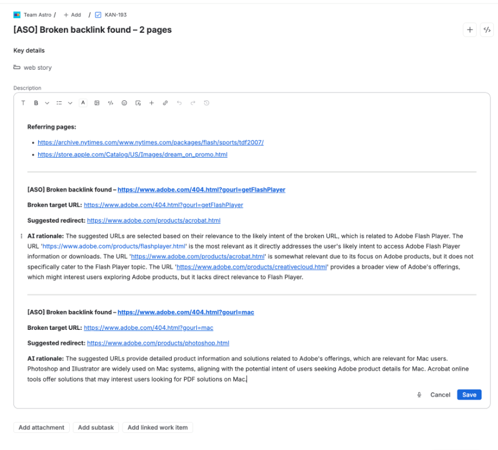{align="center"}

现在，两个反向链接在&#x200B;**票证链接**&#x200B;列中均显示相同的Jira键，因为它们属于一个已分组的票证。

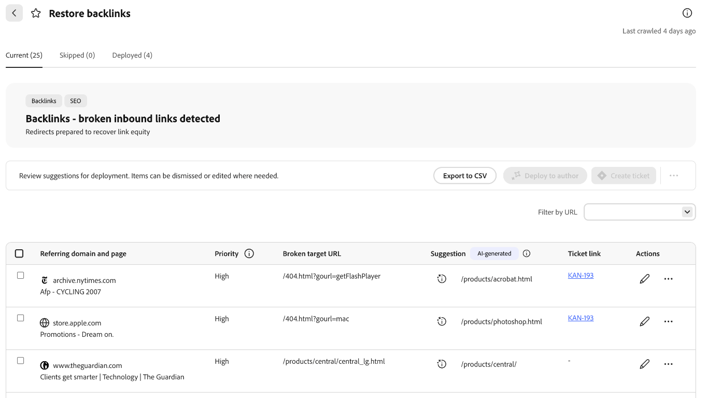{align="center"}

### 示例：带有代码修补程序附件的票证 {#example-core-web-vitals}

当Sites Optimizer为所选问题建议代码修补程序时，该修补程序将附加到Jira票证。 如果应用了多个修补程序，则它们将合并到一个文件中，以便开发人员可以查看和应用更改。 核心Web动态是一个常见示例。

1. 打开&#x200B;**核心Web动态**&#x200B;并选择要修复的页面。
1. Select **创建票证**。
1. 在对话框中，查看&#x200B;**票证名称**（如`[ASO] Core Web Vitals issue – 2 affected pages`），以及每个页面的详细信息：

   * **页面**
   * **桌面问题**：桌面上的失败量度及其值。
   * **移动设备问题**：移动设备上的失败量度及其值。
   * **推荐**：页面的建议修复。

   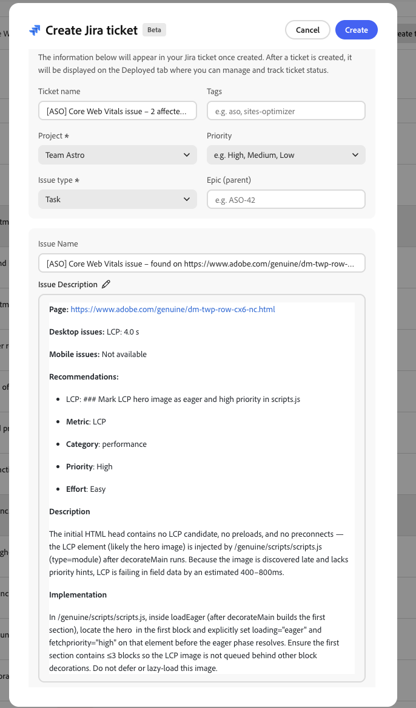{align="center"}

1. 选择&#x200B;**创建**。

如果建议为所选页面使用代码修补程序，则该修补程序将作为单个`.diff`文件附加到票证。 票证最多包含一个附件，最大为3 MB。 如果未建议使用修补程序，Sites Optimizer仍会创建包含详细信息和建议的票证，但不包含附件。

>[!NOTE]
>
>如果所选内容的组合代码修补程序大于3 MB，则无法创建票证。 Select减少了页面，并重新创建票证。

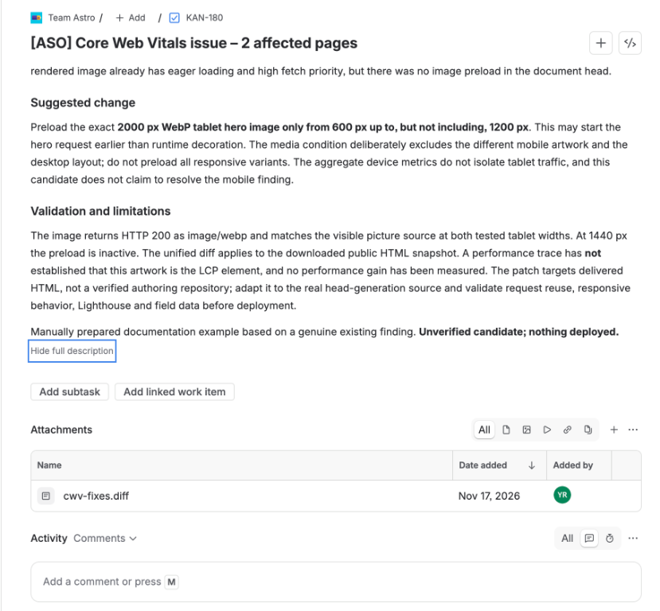{align="center"}

从Jira票证下载`.diff`文件并将其应用到您的代码存储库，例如，使用`git apply`。 该文件包含每个所选页面的修补程序：

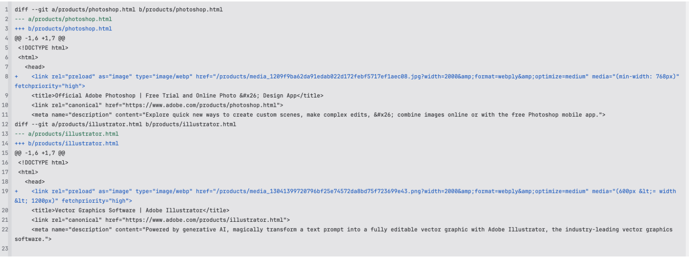{align="center"}

在合并更改之前，请复查这些更改。 有关详细信息，请参阅[准备代码修补程序](/help/documentation/opportunities/preparing-code-patches.md)。

## 每个票证包含的内容 {#ticket-contents}

| 机会 | 票证详细信息 |
|---|---|
| 缺少替代文本 | 受影响的页面，以及每个图像的页面URL、图像URL和建议的替换文本。 |
| 中断的反向链接 | 反向链接页面，以及每个反向链接损坏的目标URL和建议的重定向。 如果可以的话，AI的理由就会成立。 |
| 中断的内部链接 | 反向链接页面，以及每个链接损坏的目标URL和建议的重定向。 如果可以的话，AI的理由就会成立。 |
| Core Web Vitals | 受影响的页面，以及每个页面的桌面问题、移动设备问题和建议。 建议的代码修补程序已附加到票证。 |
| 辅助功能问题（修复ARIA标签）、颜色对比度和Forms辅助功能问题 | 受影响的URL、问题描述、错误HTML的位置以及建议的修复。 当代码修复程序可用时，它会附加到票证。 |

## 票证创建疑难解答 {#ticket-errors}

如果Sites Optimizer显示“无法创建Jira票证”，请检查以下各项：

* **项目和问题类型**：选定的项目和问题类型仍然存在于Jira中，并且连接的帐户可以在该项目中创建问题。
* **必填字段**： Jira项目不需要Sites Optimizer未填写的额外字段，例如自定义必填字段。 选择不含额外必填字段的项目或问题类型，或要求您的Jira管理员将这些字段设为可选字段。
* **优先级和父级**：**优先级**&#x200B;和&#x200B;**Epic（父级）**&#x200B;完全匹配Jira站点中存在的值，包括大小写。
* **附件大小**：对于带有代码修补程序的票证，组合修补程序为3 MB或更小。 Select减少了问题，然后重试。
* **连接状态**：在&#x200B;**设置**&#x200B;中，**连接到Jira云**&#x200B;状态为&#x200B;**已连接**。 如果它显示&#x200B;**需要重新授权**，请选择&#x200B;**重新连接到Jira**。

## 常见问题解答 {#faq}

+++我是否可以为每个问题创建一个票证，而不是一个分组票证？

不会。 选择多个问题始终会创建一个分组票证。

+++

+++我可以更改一个票证的项目或问题类型吗？

是。 在&#x200B;**创建Jira票证**&#x200B;对话框中更改&#x200B;**项目**&#x200B;或&#x200B;**问题类型**。 更改仅适用于该票证。 要更改所有新票证的默认值，请在&#x200B;**设置**&#x200B;中更新&#x200B;**票证创建默认值**。

+++

+++Sites Optimizer是否显示Jira票证的状态？

Sites Optimizer在问题列表的&#x200B;**票证链接**&#x200B;列中显示指向Jira票证的链接。 在Jira中管理票证本身，包括其状态、被分派人和评论。

+++

+++我可以使用Jira数据中心或Jira服务器吗？

不会。 该集成仅支持Jira Cloud。

+++

## 另请参阅 {#also-see}

* [Sites Optimizer 设置](/help/documentation/settings.md)
* [机会概述](/help/documentation/opportunities/overview.md)
* [准备代码修补程序](/help/documentation/opportunities/preparing-code-patches.md)
