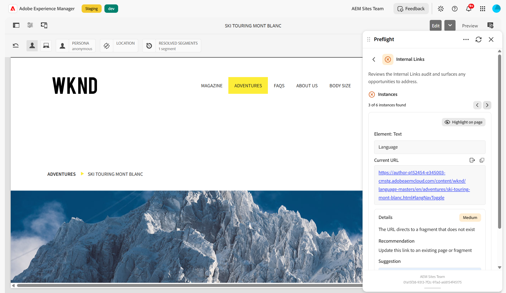

# Preflight 中的审核结果

审核完成后， Preflight会在结果仪表板中显示其结果。 仪表板显示按审核类别分组的整体结果仪表及其找到的业务机会。 在每个类别中，单独的审计都会确定需要审查或修复的特定项目。

## 工具栏

结果仪表板顶部的工具栏提供当前运行的操作：

* **重新分析** — 在当前页面上启动全新的审核运行。 重新分析始终会放弃显示的结果，并再次运行每次审核，因此可在需要新的结果时使用它，例如，在编辑页面后。 在工具栏中选择&#x200B;**重新分析**。
* **导出** — 将当前运行下载为&#x200B;**CSV** （电子表格友好）或&#x200B;**PDF** （带格式的文档）文件。 根据您的环境，从工具栏或&#x200B;**更多操作** (**...**)中选择&#x200B;**导出** 菜单。
* **设置** — 使用&#x200B;**显示网站导航链接**&#x200B;以包含网站导航链接（当前仅内部链接）。 选择齿轮图标或打开&#x200B;**更多操作** (**...**) 并选择&#x200B;**设置**。 运行之前或运行完成之后设置可用，但在运行审核时或在通用编辑器中不可用。 请参阅[包含网站导航链接](./opportunities/seo/internal-links.md#include-site-navigation-links)。

如果在运行后更改设置，则&#x200B;**重新分析**&#x200B;上的点和标签&#x200B;**重新分析以应用新设置**&#x200B;表示显示的结果使用了不同的设置。 选择&#x200B;**重新分析**&#x200B;以将保存的设置应用到新运行。

在导出时，您还可以选择要包含的内容：

* **包含元数据表** — 添加运行详细信息的表，如主机、内容路径和生成详细信息。
* **包括通过的审核** — 包括没有机会通过的审核，而不仅仅是找到的机会。

>[!NOTE]
>
>PDF导出始终以英语生成，无论界面语言如何。 CSV导出尽可能遵循您的界面语言。

## 结果计量器

在仪表板顶部，结果表反映了总体审核结果。 它显示已完成但无业务机会的审核的百分比（标记为&#x200B;**%通过**），以及所有审核中找到的业务机会总数。 例如，**85%通过**&#x200B;意味着85%的已完成的审核未找到机会。 此百分比描述审核结果，而不是整个运行的进度。

{align="center"}

当您查看从上一个会话重新加载的运行时，标题显示它是在多久之前执行的 — 例如，*昨天*。 有关详细信息，请参阅[继续上一个会话](./audits.md#continue-a-previous-session)。

在审核仍在运行时，仪表板显示&#x200B;**正在分析页面**，其下方状态较短。 在指定的审核类别到达之前，最初会显示一个进度条。 之后，处理指示器只显示在每个仍在运行的审核旁边，而不会显示在类别上。 当所有审核完成时，计量器会显示最终通过的百分比和机会计数。

## 审核类别

预检将相关审核分组为多个类别，如&#x200B;**SEO**&#x200B;和&#x200B;**辅助功能**。 每个类别都会显示为一个卡片，其中显示了找到的业务机会数量，或指示其所有审核通过时没有业务机会。

展开类别可查看其各个审核。 每次审核都会显示它是否通过或找到业务机会、简短描述以及找到的业务机会计数。 选择发现机会打开其详细信息页面的审核。

当某个类别的某些审核仍在运行时，该类别会显示结果。 其状态显示为，例如，到目前为止已通过&#x200B;**3/3次审核**。 此计数仅包括返回结果的审核，因此，随着更多结果的到来，此计数会发生变化。 展开类别以查看哪些审核仍在运行。 没有商机的类别仅在完成其未决工作后才显示其全清除复选标记。

有关审计类别的完整列表以及每个类别中的审计，请参阅[印前检查审计类别](./overview.md#preflight-audit-categories)。

## 机会详细信息

详细信息页面显示所选审核找到的业务机会。 当同一问题出现在多个位置时，每个实例都称为一个实例。 使用导航器（**上一个实例**&#x200B;和&#x200B;**下一个实例**）逐一浏览这些实例；它显示您的位置，例如，找到&#x200B;*个实例中的* 1。 要返回到结果仪表板，请选择审核标题旁边的返回箭头；仪表板将重新打开，并展开审核的类别。

对于在页面上标识特定URL的审核，**Element**&#x200B;部分显示在卡顶部以引入该项目，而机会的其余部分则在其自己的部分跟随在该项目下方。

当多个机会影响同一项目时（例如，同一链接存在多个问题），Preflight会将它们一起显示在一张卡片上，每个卡片都在标题为其实例编号的单独部分中，如&#x200B;**实例3**。 然后导航器显示一个范围而不是单个位置，例如，找到&#x200B;*的12个实例中的* 3-5。

{align="center"}

每个机会包括：

* 有关机会的详细信息，如问题描述、建议，以及相关的WCAG规则和合规性级别（用于辅助功能）。
* 一个&#x200B;**Element**&#x200B;部分，用于标识页面上受影响的元素，在页面&#x200B;**上显示**&#x200B;高亮按钮。 当元素具有可读文本时，节的标题为&#x200B;**元素：文本**&#x200B;并显示该文本；否则，节的标题为&#x200B;**元素：选择器**&#x200B;并显示元素的CSS选择器。 对于&#x200B;**内部链接**&#x200B;和&#x200B;**规范**&#x200B;机会，**当前URL**&#x200B;部分也显示涉及的URL。 选择&#x200B;**复制URL**&#x200B;以将其复制到剪贴板，或选择&#x200B;**在新标签中打开**&#x200B;以将其打开。
* 包含建议修复的&#x200B;**建议**&#x200B;部分。 当建议由人工智能生成时，它会被标记为人工智能生成的建议，并且可能包括解释所建议修复的简短理由。

### 筛选实例

有些审核会提供一个过滤器，该过滤器将详细信息页面集中到要审核的实例上。 当审核提供过滤器图标时，**实例**&#x200B;标题旁边会显示一个过滤器图标。 选择图标，然后选择一个选项。 每个审核的页面都介绍了其过滤器选项。

当选择默认选项以外的选项时，其名称会显示在过滤器图标旁边，并且导航器只执行匹配实例的步骤。 如果没有匹配项，预检将显示&#x200B;**没有匹配此筛选器的实例。** 当一张信息卡显示同一项目的多个机会时，过滤器可以隐藏其中的一些机会。

过滤器不会更改结果仪表板或导出报告上的机会计数。

## 在页面上突出显示

审核完成后，您可以直接在页面上突出显示opportunity ，从而快速找到并了解它。

“印前检查”会在上下文中突出显示受影响的元素，将面板中的结果连接到内容中的确切位置。 这样，您无需在页面中手动搜索就能更轻松地审阅和解决机会。

1. 在要审核的页面的上下文中打开“印前检查”面板，然后选择&#x200B;**分析页面**&#x200B;以运行审核。
1. 从结果仪表板中选择审核，然后选择要复查的机会。
1. 选择&#x200B;**在页面**&#x200B;上突出显示。 预览会自动滚动到相关区域并突出显示相应的元素，因此您可以轻松地在上下文中识别和优化机会。

不可能对每个机会都高亮显示 — 例如，当机会未与特定元素关联时，该元素将隐藏，或者不再位于页面上。 在这些情况下，页面&#x200B;**上的**&#x200B;突出显示按钮将灰显；将鼠标悬停在上面可查看原因。

在通用编辑器中，**辅助功能**&#x200B;机会尚不支持高亮显示；**在页面**&#x200B;上高亮显示按钮呈灰显状态，您可以将鼠标悬停在该按钮上以查看原因。

在通用编辑器中，Preflight只能突出显示可编辑的内容。 如果受影响的元素不是可编辑内容的一部分，则&#x200B;**在页面**&#x200B;上突出显示的按钮将灰显；将鼠标悬停在该按钮上可查看原因。 如果元素本身不可直接编辑，但其最近的可编辑块为，则Preflight会突出显示该块，并添加注释来解释原因。

在AEM Sites页面编辑器和Adobe Managed Services (AMS)中，突出显示还需要&#x200B;**编辑模式**。 在&#x200B;**预览模式**&#x200B;中，Preflight显示&#x200B;**突出显示不可用问题**&#x200B;通知；切换到&#x200B;**编辑模式**&#x200B;以突出显示页面上的元素。

## 作业ID

每个Preflight运行都有一个唯一的作业ID，显示在面板底部。 当管理员对特定运行进行故障排除时，此插件将非常有用。 将鼠标悬停在ID上并选择其右侧显示的复制图标；该ID将会复制到剪贴板中，并且会显示一条确认消息。 在报告问题时包含此ID。

在通用编辑器之外使用Preflight时（例如，通过Sidekick或小书签），面板页脚还会将您的组织名称显示在作业ID上方。 在通用编辑器中，您的组织而是显示在AEM标题中。
